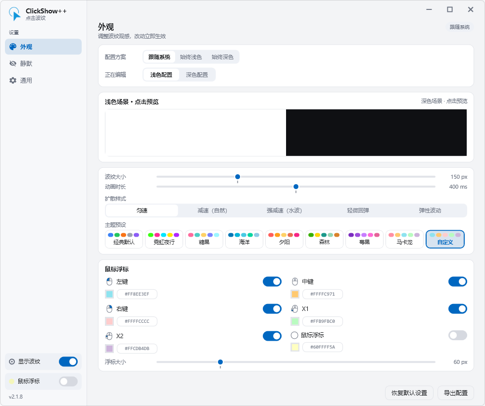
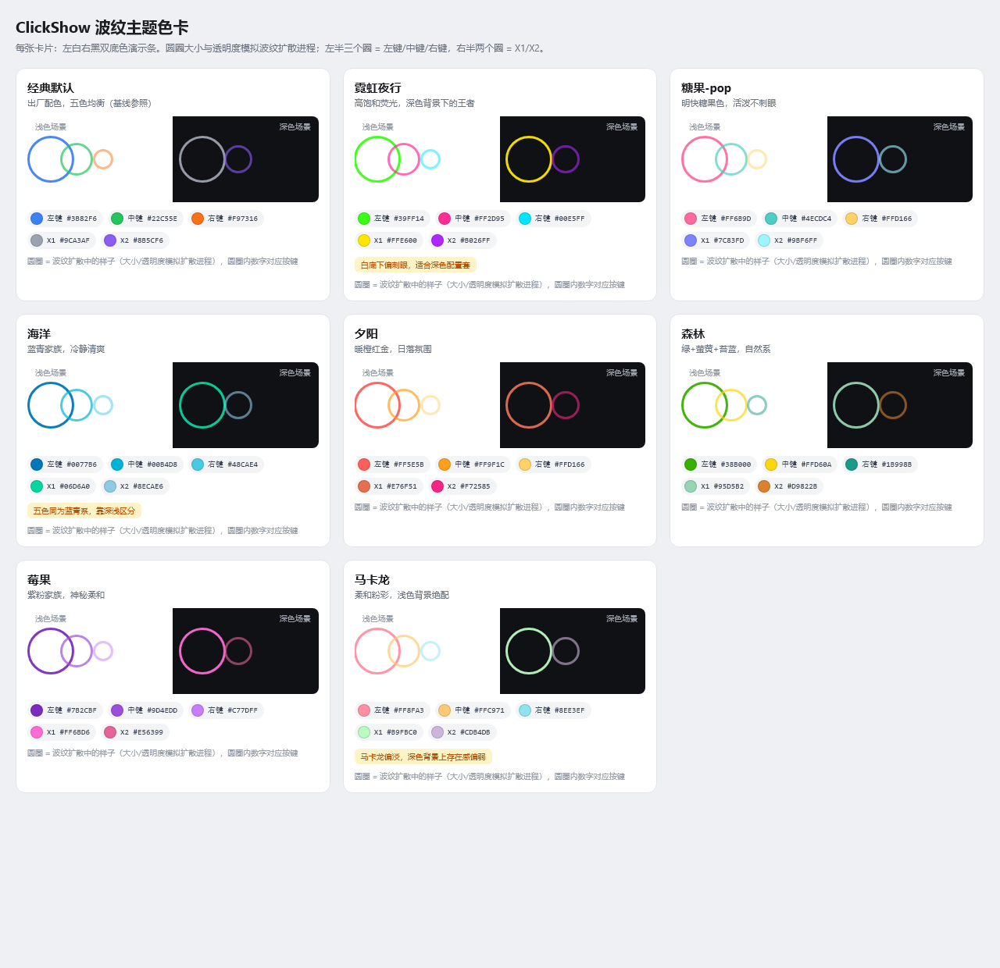

[简体中文](README.md) | [English](README.en-US.md) | [日本語](README.ja-JP.md) | [한국어](README.ko-KR.md) | **Español** | [Français](README.fr-FR.md) | [Deutsch](README.de-DE.md) | [Português (Brasil)](README.pt-BR.md) | [Русский](README.ru-RU.md) | [Italiano](README.it-IT.md)

# ClickShow++ 2.1

Embellecedor de clics del ratón para Windows. Cada clic izquierdo, central, derecho, X1 y X2 extiende una onda de color junto al cursor.




> Reescritura moderna de [cuiliang/ClickShow](https://github.com/cuiliang/clickshow) (basada en 1.4.1). Gracias al autor original. Interfaz y funciones totalmente reescritas; solo Windows 10/11.

## Funciones

### Onda de clic
- Color y activación independientes para los cinco botones (izq/central/der/X1/X2), con selector de color y entrada hexadecimal;
- **8 temas de color predefinidos**: Clásico / Neón nocturno / Caramelo / Océano / Atardecer / Bosque / Baya / Macarrón — aplicación con un clic;



- **Duración de la animación** ajustable de 200 a 600 ms;
- **5 estilos de difusión**: lineal / desaceleración (natural) / frenado fuerte (agua) / ligero rebote / elástico;
- Vista previa con doble fondo: prueba el efecto en escenas claras y oscuras al instante.

### Perfiles claro y oscuro
Los temas claro y oscuro se guardan por separado (tamaño, colores, duración, estilo); cambian con el tema del sistema o se fijan a uno.

### Punto del ratón
Indicador circular que sigue al cursor, con tamaño y color ajustables y activación independiente.

### Silencio
- **Ocultar en pantalla completa**: sin efectos cuando la ventana en primer plano llena la pantalla — juegos y vídeos limpios;
- **Silencio por programa**: añade programas (escribiendo, explorando o capturando el primero plano) para ocultar el efecto mientras estén activos.

### Idioma de la interfaz
简体中文 / English / 日本語 / 한국어 / Español / Français / Deutsch / Português (Brasil) / Русский / Italiano. Sigue el idioma del sistema en el primer inicio; se cambia en Ajustes.

### Bandeja
- Clic izquierdo en el icono de la bandeja para abrir Ajustes;
- Menú contextual: abrir ajustes / pausar onda / salir;
- La pausa surte efecto al instante y se restaura limpiamente.

## Requisitos

Windows 10 1809+ o Windows 11 (x64). Tiempo de ejecución incluido — **no se necesita .NET**.

## Instalación

**Elige versión**: `ClickShow-Setup-2.1.8.exe` incluye el runtime de .NET (~63 MB) y funciona en cualquier Windows 10/11; `ClickShow-Setup-2.1.8-lite.exe` ocupa solo ~2 MB pero **requiere .NET 8 Desktop Runtime (x64)**; sin él la aplicación no arranca (el instalador lo detecta y ofrece la descarga). Si dudas, usa la completa.

También hay dos portátiles: `ClickShowPlusPlus-Portable-2.1.8.zip` (completa, ~63 MB) y `ClickShowPlusPlus-Portable-2.1.8-lite.zip` (Lite, ~0,6 MB, mismo requisito).

1. Descarga ClickShow-Setup-2.1.8.exe desde la página de Releases de este repositorio;
2. Ejecuta el asistente: ruta de instalación personalizada (si eliges la raíz de una unidad se añade una carpeta automáticamente); accesos directos opcionales;
3. Si hay una versión anterior en ejecución, el instalador pedirá cerrarla.

Versión portátil: descarga ClickShowPlusPlus-Portable-2.1.8.zip, descomprime y ejecuta — sin instalación; la configuración vive en %APPDATA%/ClickShow.

## Actualizar desde 1.x

- Tus ajustes antiguos (`Documentos/ClickShow.setting`) migran automáticamente al primer inicio a `%APPDATA%/ClickShow/setting.json` — colores y opciones se conservan;
- Los perfiles claro y oscuro comienzan como copias idénticas;
- Instalar sobre la versión anterior mantiene ajustes y autoarranque.

## Compilar

```
dotnet publish ClickShow/ClickShow.csproj -c Release -r win-x64 --self-contained true -p:PublishSingleFile=true -o publish
```

Instalador: compila `installer/ClickShow.iss` con [Inno Setup 6](https://jrsoftware.org/isinfo.php).

## Preguntas frecuentes

- **¿No hay onda en pantalla completa?** "Ocultar en pantalla completa" está haciendo su trabajo — desactívalo en Ajustes;
- **¿"Pausar onda" en la bandeja está gris?** El gancho del ratón no se instaló (raro) — reinicia la aplicación;
- **¿Entrada de autoarranque rota tras desinstalar?** El desinstalador limpia la entrada del registro automáticamente.

## Historial

### 2.1.8 (2026-11)
- Esquinas redondeadas con borde de 1px, acorde con las tarjetas;
- La tarjeta «Personalizado» muestra los cinco colores actuales;
- El botón de actualización usa el color de acento solo cuando hay novedades.

### 2.1.7 (2026-11)
- Iconos de ratón completos con el botón correspondiente resaltado; X1/X2 comparten los dos botones laterales izquierdos;
- El punto usa un icono circular con el color actual;
- La tarjeta «Personalizado» muestra los cinco colores actuales en vivo;
- Se eliminan los botones «Cerrar» redundantes de cada página.

### 2.1.6 (2026-11)
- Barra de título dibujada por la app: los botones de ventana se integran arriba a la derecha y maximizar no deja bordes negros;
- Los temas predefinidos pasan a tarjetas que muestran los cinco colores;
- Iconos de ratón para izquierdo, central, derecho, X1, X2 y el punto;
- Selector de color renovado: cuadrado SV, barra de tono, alfa, HEX/RGB y muestras.

### 2.1.5 (2026-11)
- Restaurados los ocho temas predefinidos (Forest, Berry y Macaron se perdieron en el rediseño de la 2.1);
- Los campos hexadecimales se actualizan al instante al elegir un tema o un color.

### 2.1.4 (2026-11)
- La tarjeta de actualización cambia de idioma al instante al cambiar el idioma de la interfaz;
- Se sustituyó el rectángulo de foco punteado por un contorno redondeado suave.

### 2.1.3 (2026-11)
- Corregido el error «descarga fallida» tras completarse la descarga en la actualización integrada (el archivo seguía abierto al verificarlo);
- La barra de progreso ahora muestra el progreso real, con el porcentaje y el tamaño en su propia línea;
- Corregido el análisis de versión en la ruta alternativa de comprobación.

### 2.1.2 (2026-11)
- Corregido el retraso del punto del ratón al moverlo rápido;
- Corregido el cierre inesperado al abrir el selector de color; el campo hexadecimal ya no corta el texto;
- Nuevos iconos laterales (aspecto, silencio, ondas y punto); el del punto muestra el color actual en tiempo real.

### 2.1.1 (2026-10)
- Interfaz reescrita: ajustes en una sola ventana, temas claro/oscuro según el sistema, 10 idiomas;
- Render de la onda rehecho: animación por transformación de escala (fotogramas completos en pantallas de alta frecuencia), antialiasing vectorial, duración y estilo de difusión ajustables;
- 8 temas de color predefinidos, perfiles claro y oscuro independientes;
- Ocultación en pantalla completa y silencio por programa;
- Selector de color + hexadecimal; pausa desde la bandeja; importar/exportar configuración;
- .NET Framework 4.7.2 → .NET 8 (archivo único autocontenido), instalador con Inno Setup.

### 1.4.1 y anteriores
Ve las [versiones del proyecto original](https://github.com/cuiliang/clickshow/releases).

## Licencia
Misma licencia que el proyecto original (ver LICENSE). Gracias a [cuiliang](https://github.com/cuiliang) por el ClickShow original.
