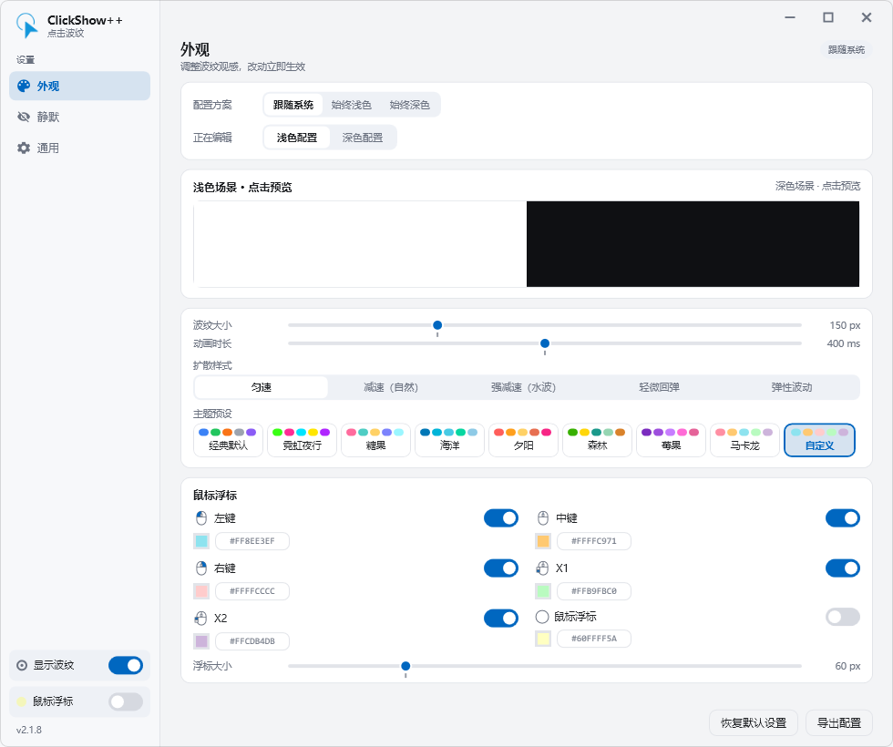
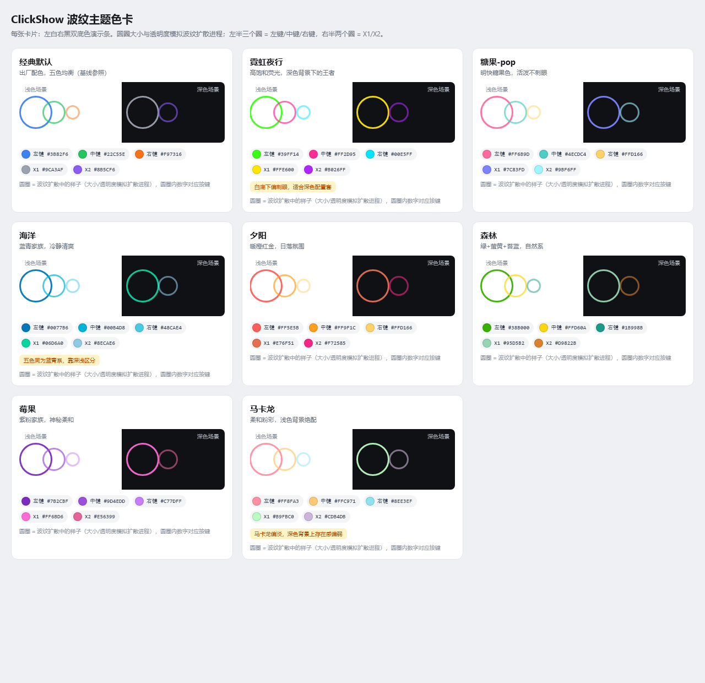

[简体中文](README.md) | [English](README.en-US.md) | [日本語](README.ja-JP.md) | [한국어](README.ko-KR.md) | [Español](README.es-ES.md) | [Français](README.fr-FR.md) | [Deutsch](README.de-DE.md) | **Português (Brasil)** | [Русский](README.ru-RU.md) | [Italiano](README.it-IT.md)

# ClickShow++ 2.1

Embelezador de cliques do mouse para Windows. Cada clique esquerdo, do meio, direito, X1 e X2 expande uma onda colorida junto ao cursor.




> Reescrita moderna do [cuiliang/ClickShow](https://github.com/cuiliang/clickshow) (baseada na 1.4.1). Obrigado ao autor original. Interface e funções totalmente reescritas; apenas Windows 10/11.

## Funções

### Onda do clique
- Cor e liga/desliga independentes para os cinco botões (esquerdo/meio/direito/X1/X2), com seletor de cores e entrada hexadecimal;
- **8 temas de cores predefinidos**: Clássico / Neón noturno / Caramelo / Oceano / Pôr do sol / Floresta / Frutas vermelhas / Macaron — aplicação com um clique;



- **Duração da animação** ajustável de 200 a 600 ms;
- **5 estilos de difusão**: linear / desaceleração (natural) / frenagem forte (água) / leve rebote / elástico;
- Pré-visualização com fundo duplo: teste o efeito em cenários claros e escuros na hora.

### Perfis claro e escuro
Os temas claro e escuro são salvos separadamente (tamanho, cores, duração, estilo); seguem automaticamente o tema do sistema ou ficam fixos em um.

### Ponto do mouse
Indicador circular que segue o cursor, com tamanho e cor ajustáveis e ativação independente.

### Silêncio
- **Ocultar em tela cheia**: sem efeitos quando a janela em primeiro plano preenche a tela — jogos e vídeos limpos;
- **Silêncio por programa**: adicione programas (digite, navegue ou capture o primeiro plano) para ocultar o efeito enquanto estiverem ativos.

### Idioma da interface
简体中文 / English / 日本語 / 한국어 / Español / Français / Deutsch / Português (Brasil) / Русский / Italiano. Segue o idioma do sistema na primeira execução; alterável nas configurações.

### Bandeja
- Clique esquerdo no ícone da bandeja abre as configurações;
- Menu de contexto: abrir configurações / pausar onda / sair;
- A pausa surte efeito na hora e é restaurada sem alterar nada.

## Requisitos

Windows 10 1809+ ou Windows 11 (x64). Runtime incluído — **não precisa instalar o .NET**.

## Instalação

**Escolha a versão**: `ClickShow-Setup-2.1.8.exe` inclui o runtime .NET (~63 MB) e funciona em qualquer Windows 10/11; `ClickShow-Setup-2.1.8-lite.exe` tem apenas ~2 MB, mas **requer o .NET 8 Desktop Runtime (x64)** — sem ele o aplicativo não inicia (o instalador detecta e oferece o download). Na dúvida, use a completa.

Há também dois portáteis: `ClickShowPlusPlus-Portable-2.1.8.zip` (completo, ~63 MB) e `ClickShowPlusPlus-Portable-2.1.8-lite.zip` (Lite, ~0,6 MB, mesmo requisito).

1. Baixe o ClickShow-Setup-2.1.8.exe na página de Releases deste repositório;
2. Execute o assistente: caminho de instalação personalizado (a raiz de uma unidade recebe uma pasta automaticamente); atalhos opcionais na área de trabalho e no menu iniciar;
3. Se houver uma versão antiga em execução, o instalador pedirá para encerrá-la.

Versão portátil: baixe o ClickShowPlusPlus-Portable-2.1.8.zip, descompacte e execute — sem instalação; as configurações ficam em %APPDATA%/ClickShow.

## Atualizar da 1.x

- Suas configurações antigas (`Documentos/ClickShow.setting`) migram automaticamente na primeira execução para `%APPDATA%/ClickShow/setting.json` — cores e opções preservadas;
- Os perfis claro e escuro começam como cópias idênticas;
- Reinstalar por cima mantém todas as configurações e a entrada de inicialização.

## Compilar

```
dotnet publish ClickShow/ClickShow.csproj -c Release -r win-x64 --self-contained true -p:PublishSingleFile=true -o publish
```

Instalador: compile `installer/ClickShow.iss` com o [Inno Setup 6](https://jrsoftware.org/isinfo.php).

## Perguntas frequentes

- **Sem onda em tela cheia?** O "ocultar em tela cheia" está fazendo o trabalho dele — desative nas configurações;
- **"Pausar onda" na bandeja está cinza?** O gancho do mouse falhou ao instalar (raro) — reinicie o aplicativo;
- **Entrada de inicialização quebrada após desinstalar?** O desinstalador limpa a entrada do registro automaticamente.

## Histórico

### 2.1.8 (2026-11)
- Cantos arredondados com borda de 1 px, alinhados aos cartões;
- O cartão «Personalizado» mostra as cinco cores atuais;
- O botão de atualização fica em destaque apenas quando há versão nova.

### 2.1.7 (2026-11)
- Ícones de mouse completos com o botão correspondente destacado; X1/X2 usam os dois botões laterais esquerdos;
- O ponto usa um ícone circular com a cor atual;
- O cartão «Personalizado» mostra as cinco cores atuais em tempo real;
- Removidos os botões «Fechar» redundantes das páginas.

### 2.1.6 (2026-11)
- Barra de título desenhada pela app: botões da janela no topo direito e maximizar sem bordas pretas;
- Temas predefinidos viram cartões com as cinco cores dos botões;
- Ícones de mouse para esquerdo, meio, direito, X1, X2 e o ponto;
- Seletor de cores refeito: quadrado SV, matiz, alfa, HEX/RGB e amostras.

### 2.1.5 (2026-11)
- Os oito temas predefinidos voltaram (Floresta, Fruta e Macaron ficaram de fora no redesenho 2.1);
- Os campos hexadecimais são atualizados na hora ao escolher um tema ou uma cor.

### 2.1.4 (2026-11)
- O cartão de atualização passa a acompanhar na hora a troca de idioma da interface;
- O retângulo de foco pontilhado foi trocado por um contorno arredondado suave.

### 2.1.3 (2026-11)
- Corrigido o erro "falha no download" após o download completo na atualização integrada (o arquivo ainda estava aberto na verificação);
- A barra de progresso agora mostra o progresso real, com porcentagem e tamanho em uma linha separada;
- Corrigida a leitura de versão no caminho alternativo de verificação.

### 2.1.2 (2026-11)
- Corrigido o atraso do ponto do mouse em movimentos rápidos;
- Corrigido o fechamento inesperado ao abrir o seletor de cores; o campo hexadecimal não corta mais o texto;
- Novos ícones da barra lateral (aparência, silêncio, ondas e ponto); o do ponto mostra a cor atual em tempo real.

### 2.1.1 (2026-10)
- Interface reescrita: configurações em janela única, temas claro/escuro seguindo o sistema, 10 idiomas de interface;
- Renderização da onda refeita: animação por transformação de escala (quadros cheios em telas de alta frequência), antialiasing vetorial, duração e estilo de difusão ajustáveis;
- 8 temas de cores predefinidos, perfis claro e escuro independentes;
- Ocultação em tela cheia e silêncio por programa;
- Seletor de cores + hexadecimal; pausa pela bandeja; importar/exportar configurações;
- .NET Framework 4.7.2 → .NET 8 (arquivo único autocontido), instalador Inno Setup.

### 1.4.1 e anteriores
Veja as [versões do projeto original](https://github.com/cuiliang/clickshow/releases).

## Licença
Mesma licença do projeto original (ver LICENSE). Obrigado a [cuiliang](https://github.com/cuiliang) pelo ClickShow original.
